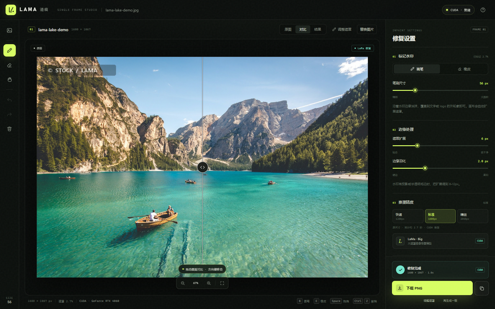
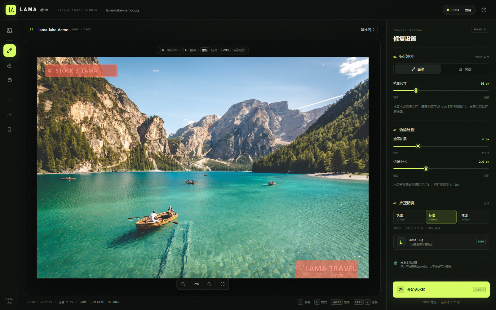
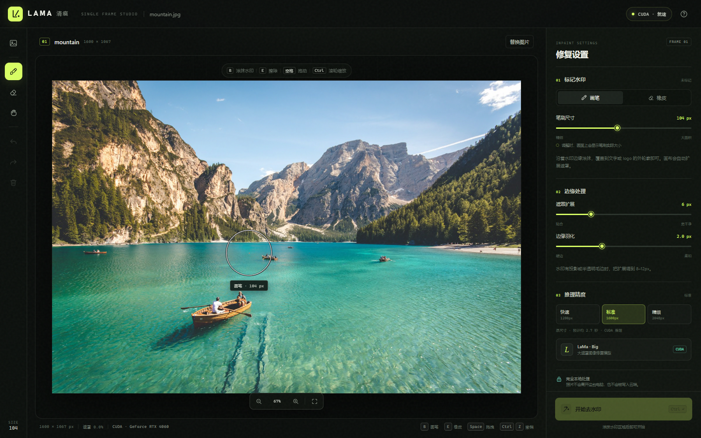
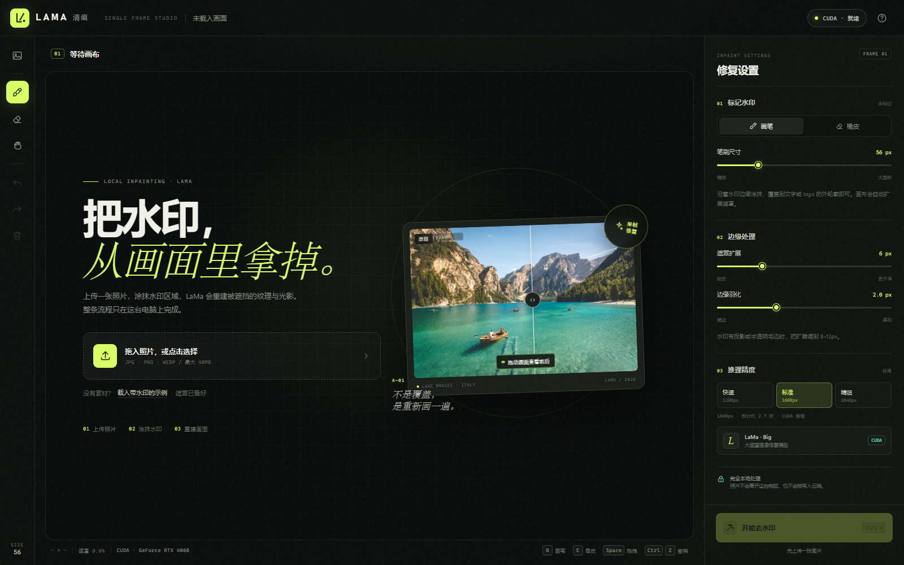
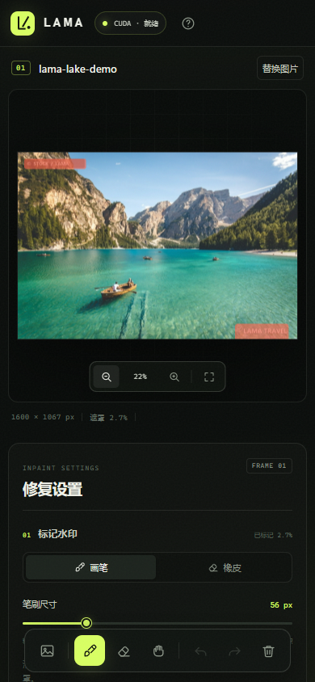

# LAMA 清痕 · 单帧去水印工作台

一套部署在本机的 LaMa 单帧图像修复工作台。上传照片、用画笔涂掉水印，LaMa 会在显卡上重建被遮挡的纹理，并在原图分辨率下合成结果。

代码仓库：<https://github.com/DuoHBshuijiao/LaMa-webui> · 许可证：MIT（中英双语，见 [LICENSE](LICENSE)）



## 当前部署

| 项目 | 状态 |
| --- | --- |
| 工作台地址 | <http://127.0.0.1:7860> |
| 运行方式 | FastAPI + Uvicorn，仅监听 `127.0.0.1` |
| 推理后端 | PyTorch 2.7.1 + CUDA 12.8 |
| 显卡 | NVIDIA GeForce RTX 4060 Laptop GPU（8GB） |
| 模型 | LaMa `big-lama` TorchScript，205.8MB |
| 单帧耗时 | 1600px 约 1–3.5 秒；3000px 输入约 2.6 秒 |
| CPU 回退 | 同一模型约 11 秒 / 1600px（`LAMA_DEVICE=cpu`） |

启动后打开 <http://127.0.0.1:7860>。所有推理都在本机完成。

## 功能

- **单帧工作流**：一次处理一张照片，上传 → 涂抹 → 重建 → 对比 → 下载。
- **真正的 LaMa**：不是模糊、裁切或覆盖，而是用大遮罩修复模型重新生成缺失区域。
- **画笔 / 橡皮 / 撤销 / 重做 / 清空**：遮罩以矢量笔画保存，可反复调整；改动笔刷大小时，画面上会直接出现对应大小的圆环预览，不必只凭数值猜粗细。
- **遮罩扩展**：0–24px 向外扩张，清理水印边缘的半透明残影。
- **边缘羽化**：0–6px 柔化合成边界，减少拼接感。
- **三档推理精度**：1280 / 1600 / 2048，长边超过上限时自动等比缩放，结果始终回到原图分辨率。
- **整张图拖动对比**：空状态示例和修复结果都可以直接拖动画面的任意位置查看前后效果，滑条可一直拉到 0% / 100% 边缘；双指滑动可直接移动对比线。
- **触摸板 / 键盘导航**：双指滚动平移画面，`Ctrl+滚轮` / 捏合缩放；放大后可用方向键移动画面（`Shift` 加速），也可用空格、手型工具或中键拖拽。
- **快速操作**：拖拽上传、`Ctrl+V` 粘贴、`Ctrl+Enter` 开始、`B/E/H` 切换工具、`[` `]` 调笔刷、`0` 适应画面、`1` 实际像素、双击对比图回到 50%。
- **本地隐私**：不调用云端 API，不加载外部字体或脚本；原图仅在内存中处理，结果 PNG 存在 `outputs/`，服务启动时清理超过 48 小时的文件。
- **示例素材**：内置一张带双水印的示例图和现成遮罩，点“载入带水印的示例”即可直接体验。

编辑时，红色半透明层就是实际发送给 LaMa 的遮罩；右侧可以调整扩展、羽化和推理精度。拖动笔刷尺寸时，画面上会出现与笔刷同尺寸的圆环和数值标签。





| 空状态 | 移动端 |
| --- | --- |
|  |  |

## 快速启动

直接运行（或双击 `run.bat`）：

```powershell
.\run.ps1
```

第一次运行会自动完成部署：创建 `.venv`、安装 `requirements.txt`、下载并校验模型，随后启动服务（一次性，约 5–15 分钟，取决于网速）。之后每次启动只需几秒。浏览器会自动打开 <http://127.0.0.1:7860>。

常用参数：

```powershell
.\run.ps1 -NoBrowser          # 不自动打开浏览器
.\run.ps1 -Port 7861          # 换端口
$env:LAMA_DEVICE = "cpu"; .\run.ps1   # 强制使用 CPU
$env:LAMA_DEVICE = "cuda"; .\run.ps1  # 强制使用显卡

# 首次部署时网络直连 PyPI / GitHub 太慢，可换镜像（模型仍做 SHA256 校验）
.\run.ps1 -IndexUrl https://mirrors.cloud.tencent.com/pypi/simple `
          -ModelUrl https://gh-proxy.com/https://github.com/enesmsahin/simple-lama-inpainting/releases/download/v0.1.0/big-lama.pt
```

## 从零安装

要求：Windows、Python 3.11–3.13（推荐 3.12；`torch 2.7.1` 尚未提供 3.14 的 wheel，`numpy 2.5+` 又要求 3.12+）。CPU 方案约需 2GB 磁盘；CUDA 版 PyTorch 约需 7GB。

```powershell
.\scripts\setup.ps1          # 自动挑选 3.12 / 3.13 / 3.11
.\scripts\setup.ps1 -Cuda    # 一并安装 CUDA 12.8 版 torch
```

脚本会创建 `.venv`、安装 `requirements.txt`、下载并校验 `models/big-lama.pt`。也可以分步执行：

```powershell
py -3.12 -m venv .venv
.\.venv\Scripts\python.exe -m pip install -r requirements.txt
.\.venv\Scripts\python.exe scripts\download_model.py
.\run.ps1
```

### 可选：CUDA 加速

PyPI 在 Windows 上提供的 `torch` 是 CPU 版本。要使用 NVIDIA 显卡，可以在部署时直接加开关（也适用于已有环境）：

```powershell
.\scripts\setup.ps1 -Cuda
```

或手动重装：

```powershell
.\.venv\Scripts\python.exe -m pip install --force-reinstall `
  --index-url https://download.pytorch.org/whl/cu128 torch==2.7.1
```

下载约 3GB。安装后确认：

```powershell
.\.venv\Scripts\python.exe -c "import torch; print(torch.cuda.is_available(), torch.cuda.get_device_name(0))"
```

服务自动使用 CUDA；设置 `LAMA_DEVICE=cpu` 可随时回退。CUDA 版与 CPU 版可以互相覆盖安装，不影响代码和数据。

## 使用

1. 拖入、选择或粘贴一张照片。
2. 用画笔完整覆盖水印；拖动笔刷尺寸时，画面上会出现对应大小的圆环预览。半透明水印、投影或描边，建议把“遮罩扩展”调到 8–12px。
3. 选择推理精度（默认 1600px）。长边超过 2048px 时模型自动等比缩小，合成时仍回到原分辨率。
4. 点击“开始去水印”，或按 `Ctrl+Enter`。
5. 在“对比”视图直接拖动画面任意位置检查细节（双指滑动也可以；`Ctrl+滚轮` 或捏合缩放，放大后用方向键移动画面），然后下载 PNG 或复制到剪贴板。

想先试一下：在空状态点击“载入带水印的示例”，示例遮罩已经准备好，直接点“开始去水印”即可。

## 架构

```text
Browser (static HTML/CSS/JS)
  │  image + transparent PNG mask + settings
  ▼
FastAPI /api/inpaint  (127.0.0.1:7860)
  │  decode / EXIF / resize / dilate mask
  ▼
LaMa big-lama (TorchScript, CUDA or CPU)
  │  padded inference
  ▼
full-resolution composite with feathered alpha
  │
  ├─ outputs/<job>.png      result, 48h retention
  └─ PNG response + X-* metadata headers
```

几个实现细节：

- 遮罩由浏览器端矢量笔画重放生成，撤销/重做不依赖巨大的 ImageData 快照。
- 推理时把图像和遮罩对称填充到 8 的倍数，输出后再裁回原始比例。
- 模型只在缩小时工作；结果用 Lanczos 放大回原分辨率，并只对遮罩区域做羽化合成，未遮挡区域保持原图像素。
- 对比线与手柄绘制在屏幕空间，不跟随图片缩放，因此无论 1600px 原图还是 2048px 推理都保持 1px 锐利细线，且不超出画面。
- 单 GPU 推理通过线程锁串行化，避免并发请求争抢显存。
- 每次请求最多 40MB、6000 万像素；模型推理长边上限 2048px。

## API

### `GET /api/health`

```json
{
  "ready": true,
  "model": "LaMa · big-lama",
  "device": "cuda",
  "gpu": "NVIDIA GeForce RTX 4060 Laptop GPU",
  "torch": "2.7.1+cu128",
  "status": "ready"
}
```

### `POST /api/inpaint`

`multipart/form-data`：

| 字段 | 类型 | 说明 |
| --- | --- | --- |
| `image` | file | JPG / PNG / WebP，≤ 40MB |
| `mask` | file | PNG，白色（或透明 Alpha）为待修复区域 |
| `dilate` | int | 遮罩扩展，0–32，默认 6 |
| `max_side` | int | 推理长边，512–2048，默认 1600 |
| `feather` | float | 合成羽化，0–8，默认 2.0 |

返回 `image/png`，并携带元数据头：

```text
X-Job-Id, X-Width, X-Height, X-Processed-Width, X-Processed-Height,
X-Inference-Ms, X-Total-Ms, X-Coverage, X-Device, X-Result-Url
```

PowerShell 调用示例：

```powershell
curl.exe -sS -D headers.txt -o result.png `
  -F "image=@samples/demo-watermarked.jpg;type=image/jpeg" `
  -F "mask=@samples/demo-mask.png;type=image/png" `
  -F "dilate=6" -F "max_side=1600" -F "feather=2" `
  http://127.0.0.1:7860/api/inpaint
```

历史结果可通过 `GET /api/results/<job_id>` 取回；`GET /api/results/<job_id>/meta` 返回该次参数。

## 目录

```text
D:\Lama
├─ app/
│  ├─ main.py          FastAPI 路由、上传限制、结果落盘
│  ├─ engine.py        TorchScript LaMa 加载、填充、推理、显存保护
│  └─ imaging.py       解码、遮罩处理、缩放、羽化合成
├─ static/
│  ├─ index.html       工作台结构
│  ├─ styles.css       视觉样式与响应式布局
│  └─ app.js           画布、笔画历史、缩放、上传、API 调用
├─ models/big-lama.pt  模型权重（下载后生成，未纳入版本控制）
├─ samples/            示例照片、示例遮罩、示例结果
├─ scripts/
│  ├─ setup.ps1        一键安装
│  ├─ download_model.py 下载 + SHA256 校验
│  ├─ make_demo.py     生成示例水印与遮罩
│  ├─ ui_check.py      Playwright 冒烟测试
│  └─ capture_preview.py 生成 README 截图
├─ outputs/            修复结果（48 小时清理）
├─ docs/               README 截图
├─ run.ps1 / run.bat   启动入口
└─ requirements.txt
```

## 模型与许可

- 本项目代码：**MIT License**，中英双语全文见 [`LICENSE`](LICENSE)。
- 模型：**LaMa (Large Mask Inpainting)**，Samsung AI Center，Apache-2.0。
- 权重：`big-lama` TorchScript 导出，来自 [simple-lama-inpainting](https://github.com/enesmsahin/simple-lama-inpainting) 的 `big-lama.pt` release；对应官方 [advimman/lama](https://github.com/advimman/lama)。
- SHA256：`7ba7aa7ac37a4d41fdbbeba3a2af7ead18058552997e3a3cd1a3b2210c9e6b4c`
- 大小：205,803,670 字节。
- 前端无构建步骤、无 Node 依赖；后端为 FastAPI。
- 第三方许可见 `THIRD_PARTY_LICENSES/`。

## 故障排查

**部署时报 `No matching distribution found for numpy==2.5.4`**  
`numpy 2.5+` 只支持 Python 3.12+，而 `torch 2.7.1` 又没有 3.14 的 wheel。用 3.11–3.13 即可；`.venv` 建错版本时删掉它再运行 `.\run.ps1`，脚本会自动挑选 3.12 / 3.13 / 3.11。

**模型未就绪 / `503`**  
确认 `models/big-lama.pt` 存在且校验通过；查看启动终端里的 `lama.workbench` 日志。

**`torch.cuda.is_available()` 为 False**  
更新 NVIDIA 驱动，确认安装的是 CUDA 版 PyTorch；也可以先用 `LAMA_DEVICE=cpu` 继续工作。

**显存不足**  
把“推理精度”降到 1280，关闭其它占用显存的程序。服务会把 CUDA OOM 转成中文提示，不会崩溃。

**端口被占用**  
`.\run.ps1 -Port 7861`。

**HEIC 无法读取**  
浏览器和当前解码链不支持 HEIC，请先导出为 JPG 或 PNG。

**第一次推理偏慢**  
服务启动时做了 320×320 预热；首次 1600/2048 推理仍可能触发 CUDA 内核选择，之后会稳定在 1–3 秒。

**想清空历史结果**  
停止服务后删除 `outputs/*.png` 和 `outputs/*.json`，或在启动时自动清理 48 小时前的文件。

**`.\scripts\setup.ps1 -Cuda` 看起来卡住了**  
CUDA 版要下载约 3 GB，安装阶段还会替换已有的 CPU 版 torch（删掉约 1.2 GB、一万多个文件），期间可能几分钟没有输出。磁盘读写跑满时耐心等 10–20 分钟即可；中途中断后重跑同一命令会继续。

## 验证记录

- 1600×1067 示例，双水印，CPU：10.7 秒，遮罩覆盖 3.2%，输出 1600×1067。
- 同图 CUDA：1.0–2.8 秒，输出 1600×1067。
- 3000×2001 输入，`max_side=2048`：2.6 秒，模型处理 2048×1366，合成回 3000×2001。
- 复测（RTX 3060 Ti 8GB，`torch 2.7.1+cu128`）：1600×1067 稳态 0.6–0.75 秒；3000×2001 → 2048 推理 1.3 秒、端到端 2.6 秒；同图 CPU 11.6 秒。
- Playwright 桌面 1600×1000 / 1024×768、移动端 390×844：无页面异常；画笔、橡皮、撤销、重做、清空、上传、示例、下载、结果视图均通过。
- 示例结果与无水印原图对比：水印区域纹理自然，未遮挡区域保持原像素。
